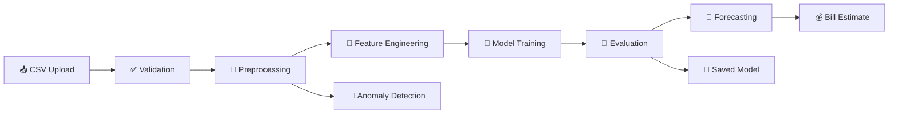

<div align="center">

# ⚡ Wattwise
### 🏠 Smart Home Energy Intelligence

**Understand it. Predict it. Reduce it.**
An AI-powered electricity analytics and forecasting platform that turns raw smart-meter data into clear, actionable insight.

<br/>

[](https://wattwise-ira9cb43qz5rfrszg3nrlb.streamlit.app/)
[](https://python.org)
[](https://scikit-learn.org)
[](https://plotly.com)
[](#-testing)
[](#-license)

<br/>

[🌐 Live Demo](https://wattwise-ira9cb43qz5rfrszg3nrlb.streamlit.app/) •
[✨ Features](#-features) •
[🏗️ Architecture](#️-architecture) •
[⚙️ Installation](#️-installation) •
[🧠 Methodology](#-methodology) •
[📊 Results](#-evaluation--results) •
[🗺️ Roadmap](#️-roadmap)

</div>

---

## 📖 Overview

Most households receive a single electricity bill each month, with no visibility into **when** or **why** energy was consumed. **Wattwise** closes that gap.

Upload historical smart-meter data and Wattwise validates it, engineers time-series features, trains and compares genuine machine-learning models, forecasts future consumption, estimates your bill, and flags unusual usage — all through an intuitive multi-page Streamlit dashboard.

> 💡 **Built on real machine learning, not hard-coded rules.** Every prediction comes from a model trained on *your* data, evaluated with strictly chronological splits to prevent data leakage.

---

## 🎯 Problem Statement

Hourly or sub-hourly smart-meter readings hide rich behavioural patterns. Wattwise answers the questions households actually care about:

| ❓ Question | 🔧 How Wattwise answers it |
| :-- | :-- |
| *When do I use the most electricity?* | 📈 Interactive consumption analytics |
| *How much will I use next week?* | 🔮 Recursive multi-step forecasting |
| *What will my bill be?* | 💰 Configurable tariff-based bill estimator |
| *Is anything behaving strangely?* | 🚨 Isolation Forest + rolling Z-score anomaly detection |

---

## ✨ Features

### 📊 Data Intelligence
| | Feature | Description |
| :-: | :-- | :-- |
| ✅ | **Dataset validation** | Automatic quality report: missing values, duplicates, sampling frequency, date range |
| 🔧 | **Column configurability** | Works with *any* CSV column names — zero hard-coded assumptions |
| 🧹 | **Preprocessing** | Duplicate removal, interpolation, resampling, unit conversion |
| 🧬 | **Feature engineering** | Calendar, cyclic, lag, and rolling-statistic features |

### 🤖 Machine Learning
| | Feature | Description |
| :-: | :-- | :-- |
| 📏 | **Baseline model** | Same-hour-yesterday reference point |
| 🌲 | **Random Forest** | Ensemble of decision trees |
| 🚀 | **Gradient Boosting** | Sequential tree ensemble |
| ⚡ | **XGBoost** *(optional)* | Enabled automatically if installed |
| ⏳ | **Chronological evaluation** | Train / validation / test split with **no shuffling** |
| 💾 | **Model persistence** | Save and reload trained models across sessions |

### 🔮 Insights & Forecasting
| | Feature | Description |
| :-: | :-- | :-- |
| 📅 | **Recursive forecasting** | 24-hour, 7-day, and 30-day-ahead predictions |
| 💰 | **Bill estimation** | Configurable tariff, fixed charges, tax, and slab pricing |
| 🚨 | **Anomaly detection** | Isolation Forest + rolling Z-score |
| 💡 | **Energy insights** | Data-driven recommendations from your own usage patterns |

---

## 🔄 How It Works



---

## 🏗️ Architecture

```text
Wattwise/
│
├── 📂 data/                        ← Your datasets live here
│   ├── energy_dataset.csv          ← your data (not committed to git)
│   ├── demo_energy_dataset.csv     ← synthetic demo data (safe to commit)
│   ├── generate_demo_data.py       ← regenerate the demo data
│   └── README.md                   ← dataset format documentation
│
├── 📂 models/                      ← Trained artifacts (auto-created)
│   ├── energy_forecaster.joblib
│   ├── model_metadata.json
│   └── evaluation_metrics.json
│
├── 📂 src/                         ← Framework-agnostic ML pipeline
│   ├── data_loader.py              ← load & validate CSV
│   ├── preprocessing.py            ← clean, resample, split
│   ├── feature_engineering.py      ← calendar + lag + rolling features
│   ├── train_model.py              ← train, compare, persist models
│   ├── evaluate_model.py           ← MAE, RMSE, R², MAPE
│   ├── predict_energy.py           ← recursive multi-step forecasting
│   └── anomaly_detection.py        ← Isolation Forest + Z-score
│
├── 📂 app/                         ← Streamlit user interface
│   ├── main.py                     ← app entry point
│   ├── utils.py                    ← shared helpers & chart theme
│   └── pages/
│       ├── 1_Dashboard.py          ← load data, quality report
│       ├── 2_Analytics.py          ← interactive charts
│       ├── 3_Forecasting.py        ← future consumption forecast
│       ├── 4_Train_Model.py        ← train & evaluate ML models
│       ├── 5_Bill_Estimator.py     ← bill calculator + insights
│       └── 6_Anomaly_Detection.py  ← unusual-usage detection
│
├── 📂 tests/                       ← pytest suite (53 tests)
├── 📂 .devcontainer/               ← reproducible dev environment
├── ⚙️ config.py                    ← all configurable defaults
└── 📄 requirements.txt
```

---

## 🛠️ Tech Stack

| Layer | Technology |
| :-- | :-- |
| 🐍 **Language** | Python 3.10+ |
| 🧮 **Data** | Pandas, NumPy |
| 🤖 **Machine Learning** | Scikit-learn (Random Forest, Gradient Boosting, Isolation Forest), XGBoost *(optional)* |
| 📈 **Visualisation** | Plotly |
| 🖥️ **Interface** | Streamlit |
| 💾 **Persistence** | Joblib |
| 🧪 **Testing** | Pytest |

---

## ⚙️ Installation

### 1️⃣ Clone the repository
```bash
git clone https://github.com/Interestseller/Wattwise.git
cd Wattwise
```

### 2️⃣ Create a virtual environment *(recommended)*
```bash
python -m venv .venv

# Windows
.venv\Scripts\activate

# macOS / Linux
source .venv/bin/activate
```

### 3️⃣ Install dependencies
```bash
pip install -r requirements.txt
```

### 4️⃣ *(Optional)* Enable XGBoost
```bash
pip install xgboost
```

### 5️⃣ Generate the demo dataset
```bash
python data/generate_demo_data.py
```

---

## ▶️ Running the App

```bash
streamlit run app/main.py
```

The app opens at **http://localhost:8501** 🎉

### 🧭 Recommended Workflow

| Step | Page | Action |
| :-: | :-- | :-- |
| 1️⃣ | 🏠 **Dashboard** | Upload your CSV (or use the demo dataset) |
| 2️⃣ | 🏠 **Dashboard** | Select timestamp column, target column, and unit |
| 3️⃣ | 🤖 **Train Model** | Configure settings and click **Train Models** |
| 4️⃣ | 📊 **Analytics** | Explore historical consumption charts |
| 5️⃣ | 🔮 **Forecasting** | Generate a 24h / 7d / 30d forecast |
| 6️⃣ | 💰 **Bill Estimator** | Configure your tariff and view cost estimates |
| 7️⃣ | 🚨 **Anomaly Detection** | Detect unusual consumption events |

---

## 📂 Dataset Requirements

Place your file at `data/energy_dataset.csv`, or upload it directly from the **Dashboard** page.

**Minimum format**

```csv
DateTime,Global_active_power
2024-01-01 00:00:00,1.25
2024-01-01 01:00:00,1.18
2024-01-01 02:00:00,1.42
```

- 🕒 At least one **timestamp** column (any parseable datetime format)
- 🔢 At least one **numeric** column (power in kW/W or energy in kWh/Wh)

**Extended format** *(unlocks additional features)*

```csv
DateTime,Global_active_power,Voltage,Global_intensity
2024-01-01 00:00:00,1.25,240.1,5.2
2024-01-01 01:00:00,1.18,239.8,4.9
```

| Attribute | Minimum | ⭐ Recommended |
| :-- | :-: | :-: |
| Duration | 2 weeks | 3–12 months |
| Frequency | 15 min | 1 hour |
| Target missing | < 20% | < 5% |

**📦 Public datasets to try**

| Dataset | Description | Link |
| :-- | :-- | :-- |
| UCI Household Power | 2 years, 1-minute resolution | [archive.ics.uci.edu](https://archive.ics.uci.edu/dataset/235) |
| UK Smart Meters | Half-hourly London households | [data.london.gov.uk](https://data.london.gov.uk/dataset/smartmeter-energy-use-data-in-london-households) |

> ⚠️ Always verify a dataset's licence before using or redistributing it.

---

## 🧠 Methodology

### 🧬 Engineered Features

| Feature | Type | Description |
| :-- | :-: | :-- |
| `hour` | 📅 Calendar | Hour of day (0–23) |
| `day_of_week` | 📅 Calendar | Day of week (0 = Mon, 6 = Sun) |
| `month` | 📅 Calendar | Month of year |
| `is_weekend` | 📅 Calendar | `1` if Saturday or Sunday |
| `hour_sin`, `hour_cos` | 🔄 Cyclic | Circular encoding so hour 23 ≈ hour 0 |
| `lag_1`, `lag_24` | ⏪ Lag | Consumption 1 and 24 steps ago |
| `lag_168` | ⏪ Lag | Same hour last week (hourly data) |
| `rolling_mean_24` | 📉 Rolling | Mean over the last 24 steps |
| `rolling_std_24` | 📉 Rolling | Standard deviation over the last 24 steps |

### 🔄 Why cyclic encoding?
Integer encoding treats hour 0 and hour 23 as 23 units apart. Sine/cosine encoding wraps the cycle so midnight and 11 PM are neighbours — matching physical reality.

### 🚫 Why no data shuffling?
Time-series observations are not independent. Shuffling before splitting causes **data leakage**: the model glimpses future patterns during training, producing unrealistically optimistic scores. Every split in Wattwise is **strictly chronological**.

### 🔁 Recursive forecasting
1. Predict step *t+1* from real historical lags
2. Feed that prediction back in as `lag_1` for step *t+2*
3. Repeat until the full horizon is covered

> Error accumulates with horizon — this is honest, expected behaviour for recursive strategies.

---

## 📊 Evaluation & Results

| Metric | Meaning | 🎯 Good value |
| :-- | :-- | :-- |
| **MAE** | Mean absolute error | Small; same units as target |
| **RMSE** | Root mean squared error (penalises large misses) | Close to MAE |
| **R²** | Variance explained | Close to 1.0 |
| **MAPE** | Mean absolute % error | < 10–15% *(omitted near zero)* |

**Example run** on `demo_energy_dataset.csv` (2 years, hourly, synthetic):

| Model | MAE (kW) | RMSE (kW) | R² |
| :-- | :-: | :-: | :-: |
| 📏 Baseline (prev-day) | 0.21 | 0.28 | 0.64 |
| 🌲 Random Forest | 0.13 | 0.17 | 0.84 |
| 🏆 **Gradient Boosting** | **0.12** | **0.16** | **0.86** |

> ℹ️ These figures come from **synthetic demonstration data** and do not represent real-household accuracy. Results on real data will vary.

---

## 🧪 Testing

```bash
pytest tests/ -v
```

All **53 tests** should pass, covering:

- ✅ Dataset loading and validation
- ✅ Timestamp parsing & missing-value handling
- ✅ Feature engineering (including data-leakage checks)
- ✅ Chronological train/test splitting
- ✅ Model training and evaluation
- ✅ Multi-step forecasting
- ✅ Bill calculations
- ✅ Anomaly detection
- ✅ Invalid-input handling

---

## ⚠️ Limitations

1. 📉 **Recursive error growth** — 30-day forecasts are inherently less accurate than 24-hour ones.
2. 🌦️ **No weather integration** — temperature data would notably improve HVAC-heavy households.
3. 🏠 **Single-household models** — trained models do not transfer between homes.
4. 📊 **Heuristic uncertainty bands** — based on historical volatility, not statistically rigorous prediction intervals.
5. 📏 **Minimum data** — at least 168 observations (one week, hourly) are needed for lag-based models.
6. 🔌 **No appliance-level detection** — NILM requires a separate, validated model.

---

## 🔒 Privacy Considerations

- 🚫 **Never commit real household data** to a public repository — consumption patterns reveal occupancy and may fall under GDPR or similar regulations.
- 🙈 `.gitignore` excludes `data/*.csv` (except the demo file).
- 🗝️ Trained `.joblib` files can indirectly encode personal patterns — treat them as sensitive.
- 🏡 Designed for **local use**; no data is transmitted to external services.

---

## 🗺️ Roadmap

- [ ] 🌦️ Weather API integration (temperature, humidity)
- [ ] 🧠 LSTM / Transformer forecasting for longer horizons
- [ ] 🏘️ Multi-household comparison
- [ ] 🔌 Appliance-level NILM (Non-Intrusive Load Monitoring)
- [ ] 📬 Automated daily report generation
- [ ] 📱 Mobile-responsive layout
- [ ] 🐳 Docker deployment
- [ ] 📐 Rigorous prediction intervals via conformal prediction

---

## 🤝 Contributing

Contributions, issues, and feature requests are welcome!

1. 🍴 Fork the repository
2. 🌿 Create a feature branch — `git checkout -b feature/amazing-idea`
3. 💾 Commit your changes — `git commit -m "Add amazing idea"`
4. 📤 Push to the branch — `git push origin feature/amazing-idea`
5. 🔁 Open a Pull Request

---

## 📜 License

Distributed under the **MIT License**. See [`LICENSE`](LICENSE) for details.

---

## 👨‍💻 Author

<div align="center">

### **Suryansh Asati**
🎓 B.Tech Data Science Student &nbsp;|&nbsp; 🤖 Generative AI & ML Intern

[](https://github.com/Interestseller)

*Built as an AI/ML internship project with Python, Scikit-learn, Plotly, and Streamlit.*

<br/>

⭐ **If Wattwise helped you, consider giving it a star!** ⭐

Made with ❤️ and ⚡ by **Suryansh Asati**

</div>